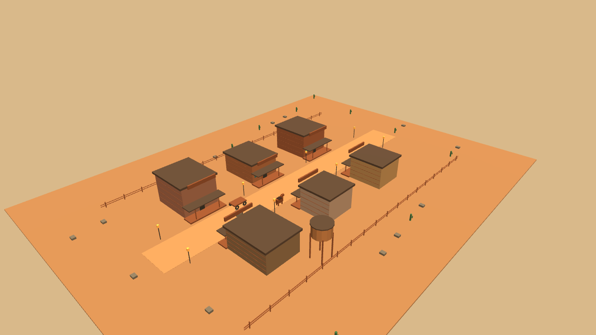

# DUSTBOUND FRONTIER
### Original 3D Western action-adventure — Godot 4 playable vertical slice

**Important:** This is an **original, self-contained prototype** of a Western open-world action-adventure, *not* Red Dead Redemption 2 and *not* a complete AAA game. The core Godot project, scenes and scripts are included. Blender models are optional. No external proprietary game assets are used.

## Open and run the playable project

1. Download/extract the zip on a **Windows PC**.
2. Install [Godot 4](https://godotengine.org/download/windows/) (Godot 4.3 or newer recommended).
3. Launch **Godot Project Manager** and click **Import**.
4. Choose `Dustbound_Frontier/project.godot` from the extracted folder.
5. Open the imported project and press **F5** in the **Godot editor** to run the main scene. (`F5` while **playing** saves the game.)
6. Click inside the game viewport to capture the mouse if necessary.

**Note:** There is no Windows `.exe` supplied. Export one using the steps below. The project is designed to play without Blender, downloaded assets, or a GPU-heavy renderer.

## Built in this playable vertical slice

- Third-person outlaw, dynamic camera yaw/pitch/zoom, walking, running, crouching, jumping and a dodge roll.
- Mount/dismount your horse **Copper**, horse follow/call, riding, galloping and horse stamina.
- Functional six-shot revolver, free/aimed raycast shooting, hit detection, reload and 42 reserve rounds.
- Original Western town: saloon, sheriff's office, store, bank, hotel, stable, street lights, tower, well, railway and abandoned mine.
- Streamed noise-based collision terrain, trees, cacti, stones, bandit camp and distant landmarks.
- Three hostile Coyote Ridge bandits, lawman, trader, residents, health/damage and basic reactions.
- Start and finish **Coyote Ridge Cleanup** at Marshal Reed, kill 3 raiders, return, get **$75** and honor.
- NPC interaction, ammunition vendor, simple wanted status, HUD, minimap, health/stamina, money, ammo and time of day.
- Dynamic light/time of day, fog, rain, three lightweight graphics settings, pause menu.
- JSON save/load (`user://dustbound_save.json`, Godot's per-user application data directory).

## Controls

| Key | Action |
|---|---|
| W A S D | Move / steer horse |
| Mouse | Orbit third-person camera |
| Scroll wheel | Camera zoom |
| Shift | Sprint / horse gallop |
| Space | Jump / horse hop |
| Ctrl | Crouch on foot |
| C | Roll on foot |
| E | Mount, dismount, talk, buy ammo |
| F | Whistle / call Copper |
| Left mouse | Fire revolver |
| Right mouse (hold) | Aim revolver |
| R | Reload revolver |
| F1 | Toggle controls tips |
| F3 | Toggle Low / Medium / High quality |
| F5 *in running game* | Save JSON progress |
| F9 | Load JSON progress |
| F6 | Cycle clear / rainy / foggy weather |
| Esc | Pause/resume menu |

## First mission walkthrough

1. Start on the main street near your horse.
2. Walk north (toward the sign reading **SHERIFF**) and press **E** near **Marshal Reed**.
3. Press **F** or find Copper, mount with **E** and ride towards the **red camp marker** east/southeast of town.
4. Defeat the 3 raiders (Left click shoots; R reloads) and return to the sheriff.
5. Talk to Marshal Reed again for **$75** and **10 honor**.

The game is intentionally a modest vertical slice. Some ambitious items listed in the original brief — swimming, climbing, trains, wildlife, fully articulated animations, advanced police navigation, rich inventory UI, multiple towns, cinematics, proper cover system and full 5-tier bounty response — are **not implemented**. The simple wanted value and sheriff reaction are an early starting point.

## Open the 3D preview in Blender

The zip contains `assets/frontier_town_preview.glb`: import with **Blender → File → Import → glTF 2.0**. All preview meshes are original and editable.

For an editable original Blender `.blend` generated with Blender itself, use `blender/build_frontier.py` from Blender's **Scripting** workspace (**Run Script**). This saves a `.blend` and `.glb` in `blender/`. The Blender-generated scene is a modeling asset and is **not required** by the Godot game; the game has its own procedural models.

## Export a Windows .exe

1. In Godot, choose **Editor → Manage Export Templates → Download and Install** (first time only).
2. Choose **Project → Export → Add... → Windows Desktop**.
3. Set the output executable path, such as `Builds/DustboundFrontier.exe`.
4. Click **Export Project**. Keep the output `.exe` and corresponding `.pck` files together if Godot generates both.
5. Run the `.exe` on Windows. Godot's **Compatibility/OpenGL** renderer helps integrated graphics.

## File map

```
Dustbound_Frontier/
├── project.godot
├── scenes/
│   ├── main.tscn
│   ├── player.tscn
│   ├── horse.tscn
│   └── npc.tscn
├── scripts/
│   ├── game.gd           # game loop, inputs, NPCs, interaction, save/load
│   ├── world.gd          # town, terrain chunks, time/weather
│   ├── geometry_kit.gd   # mesh creation
│   ├── player.gd         # controller, camera, revolver
│   ├── horse.gd          # riding, follow AI
│   ├── npc.gd            # bandit, sheriff, resident/trader AI
│   ├── mission.gd        # Coyote Ridge story mission
│   ├── hud.gd            # HUD, pause/graphics menu
│   └── minimap.gd        # 2D radar
├── assets/
│   ├── frontier_town_preview.glb
│   └── ASSET_MANIFEST.md
├── blender/
│   ├── build_frontier.py      # generates .blend using Blender
│   ├── make_preview_glb.py    # already executed for included GLB
│   └── README.md
└── docs/
    └── QUICK_START_MALAYALAM.md
```

## Preview



## Limitations and verification

A second review fixed several bugs, including terrain the player would have fallen through. See [docs/VALIDATION_REPORT.md](docs/VALIDATION_REPORT.md). This package was generated and structurally checked in an environment with **no Godot or Blender executable installed**. The scripts have **not been launched or engine-compiled here**, so the first editor run may reveal Godot-version-specific issues. No working `.exe`, `.blend`, or gameplay video can be honestly claimed from this environment. The GLB preview was created and reopened successfully as a 3D asset.

Project files are original and designed for further iteration in Godot and Blender. RDR2 is used only as genre inspiration, with no copyrighted Rockstar game assets or copied plot/characters.
